<div align="center">

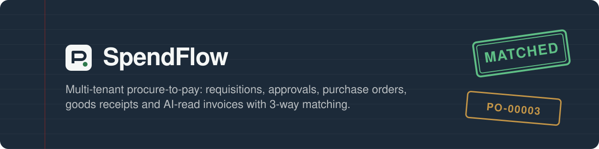

<br>

**Raise it. Approve it. Order it. Receive it. Match it. Pay it.**
<br>
A procure-to-pay app where an LLM reads the supplier's invoice and a 3-way match checks it against what was ordered and what actually arrived.

<br>


[Features](#-features) ·
[Screenshots](#-screenshots) ·
[Architecture](#-architecture) ·
[Quick start](#-quick-start) ·
[Demo walkthrough](#-demo-walkthrough) ·
[Performance](#-performance) ·
[Testing](#-testing)

</div>

---

<div align="center">
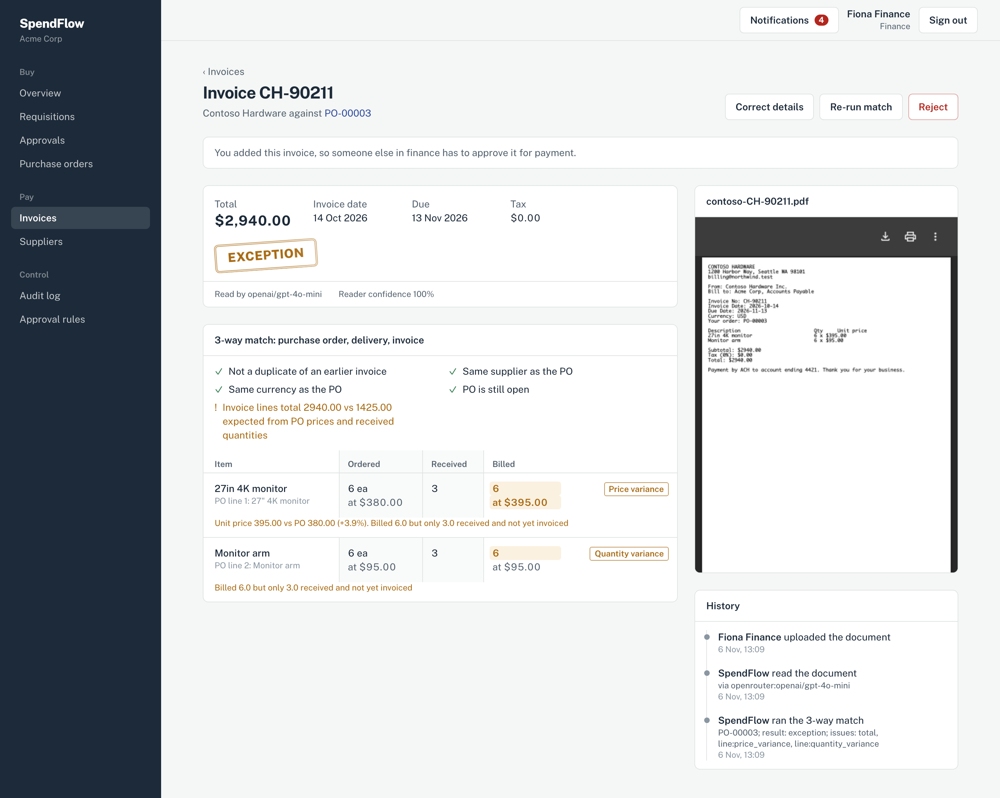
<sub>An uploaded PDF, read by an LLM and matched to PO-00003. The supplier billed 6 monitors at $395, but the PO says $380 and only 3 have arrived.</sub>
</div>

<br>

## 🧰 Tech stack

<table>
<tr>
<td width="140"><b>Backend</b></td>
<td>


</td>
</tr>
<tr>
<td><b>Data & jobs</b></td>
<td>


</td>
</tr>
<tr>
<td><b>Frontend</b></td>
<td>


</td>
</tr>
<tr>
<td><b>AI</b></td>
<td>


</td>
</tr>
<tr>
<td><b>Quality & ops</b></td>
<td>


</td>
</tr>
</table>

## ✨ Features

<table>
<tr>
<td width="50%" valign="top">

### 🏢 Multi-tenant by default
- Row-level isolation on every model with `acts_as_tenant`. The tenant comes from the JWT.
- Sidekiq jobs receive `company_id` explicitly, because tenant state doesn't cross process boundaries.
- `validates_same_tenant` rejects foreign keys that point at another company's rows.
- Request specs run with tenant enforcement switched on. That caught a real bug in login.

</td>
<td width="50%" valign="top">

### 🔐 Roles & permissions
- Pundit policies and scopes for **employee**, **manager**, **finance** and **admin**.
- Deny by default, with `verify_authorized` and `verify_policy_scoped` on every action.
- Every detail endpoint returns a `permissions` map, so the UI never guesses what you can do.

</td>
</tr>
<tr>
<td valign="top">

### ✅ Multi-level approvals
- Rules by **amount threshold** and **level**, with **department overrides** (e.g. Engineering needs finance review from $2,500, not $5,000).
- Levels are approved in order. Requesters can never approve their own requests, and rejections need a reason.
- A live preview shows who will approve a request while you're still typing it.

</td>
<td valign="top">

### 📦 Orders & deliveries
- Approved requisitions become purchase orders, with per-tenant numbering such as `PO-00042` (one atomic upsert).
- Partial deliveries are recorded as goods receipts. Over-receipt is blocked.
- PO status (*issued → part received → received*) follows the deliveries.

</td>
</tr>
<tr>
<td valign="top">

### 🤖 AI invoice reading
- Upload a PDF, photo or scan. A Sidekiq job reads it through OpenRouter with a **strict JSON schema**.
- Text PDFs go to `gpt-4o-mini` (~3s). Images go to `gemini-2.5-flash`.
- Output is validated and normalized before it touches the database. Supplier and PO are resolved from the quoted PO number, or from the closest open PO.
- No API key? An offline heuristic extractor keeps tests and demos running.

</td>
<td valign="top">

### 🧾 3-way match & AP controls
- **Price:** invoice vs PO, within the company's tolerance.
- **Quantity:** invoice vs *received and not yet invoiced*.
- Supplier, currency and PO-status checks, plus **duplicate detection**.
- Uploaders can't approve their own invoices. Approving an exception needs a written reason. Duplicates can never be approved.

</td>
</tr>
<tr>
<td valign="top">

### 📜 Audit trail
- `AuditEvent` rows are read-only once written and can't be destroyed.
- Each one records actor, action, metadata, request ID and IP.
- Shown as a timeline on every document and as a filterable company-wide log.

</td>
<td valign="top">

### ⚡ Measured performance
- 3.1M-row benchmark with composite, partial and trigram indexes.
- The approval inbox was rewritten around a denormalized "current approver".
- Before/after timings come from `EXPLAIN ANALYZE`, not estimates. [Read the write-up →](docs/PERFORMANCE.md)

</td>
</tr>
</table>

## 📸 Screenshots

<table>
<tr>
<td width="50%">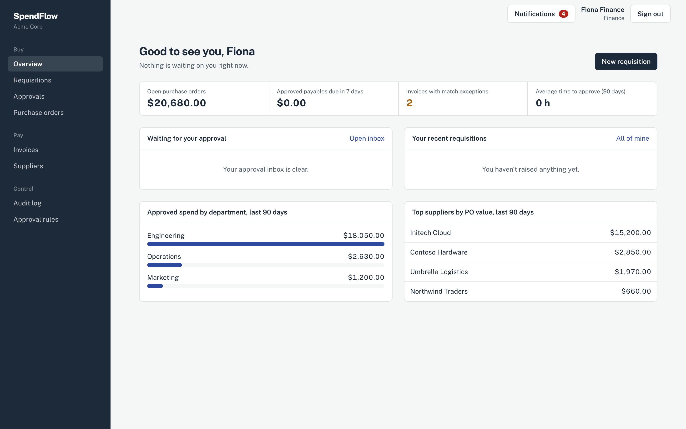<p align="center"><sub><b>Overview</b>: role-aware metrics and spend by department</sub></p></td>
<td width="50%">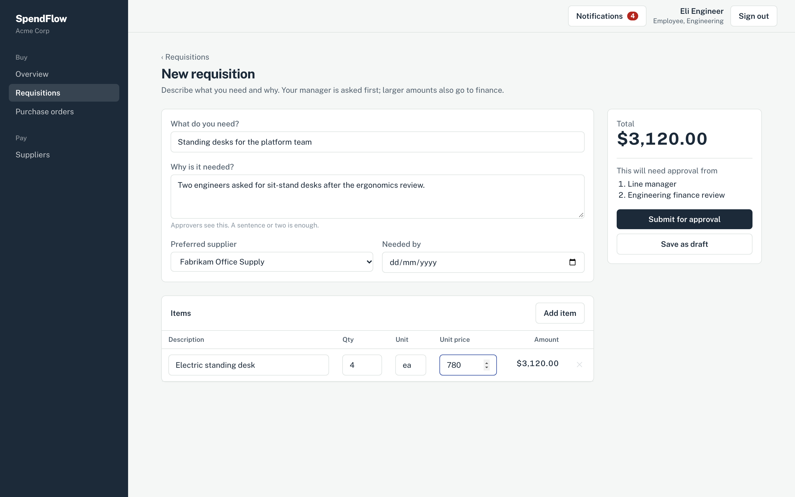<p align="center"><sub><b>New requisition</b>: the approval chain updates as you type</sub></p></td>
</tr>
<tr>
<td>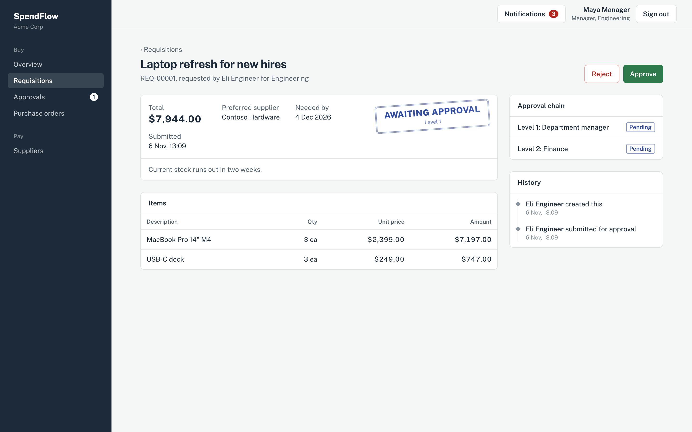<p align="center"><sub><b>Requisition</b>: status stamp, approval chain and history</sub></p></td>
<td>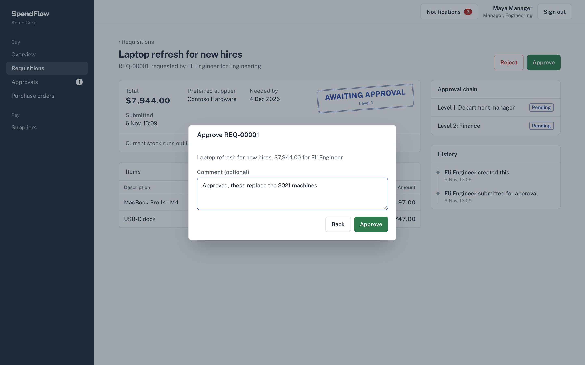<p align="center"><sub><b>Approve</b>: comments are kept in the audit trail</sub></p></td>
</tr>
<tr>
<td>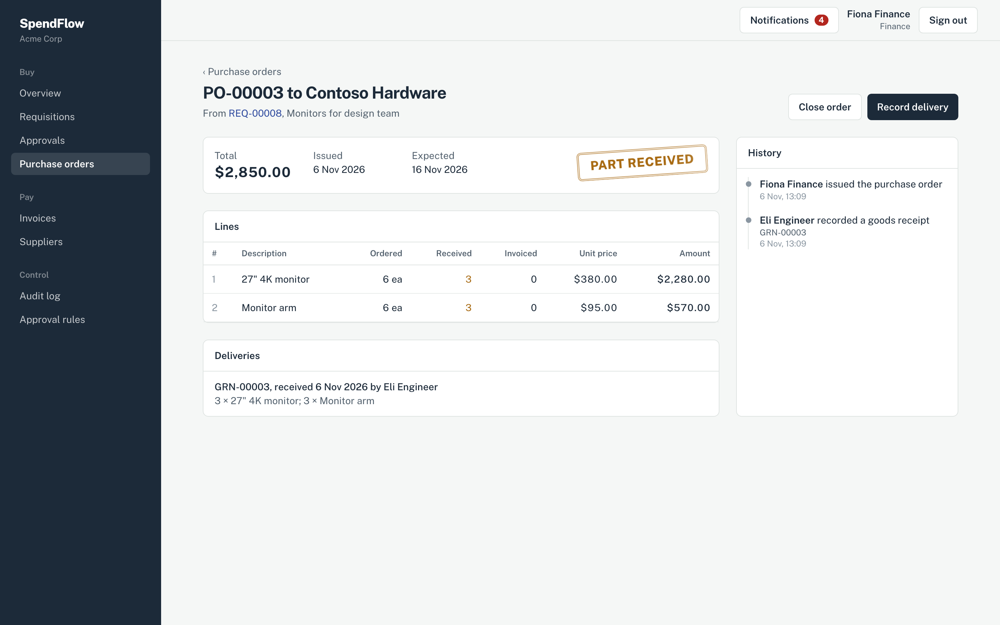<p align="center"><sub><b>Purchase order</b>: received vs ordered, per line</sub></p></td>
<td>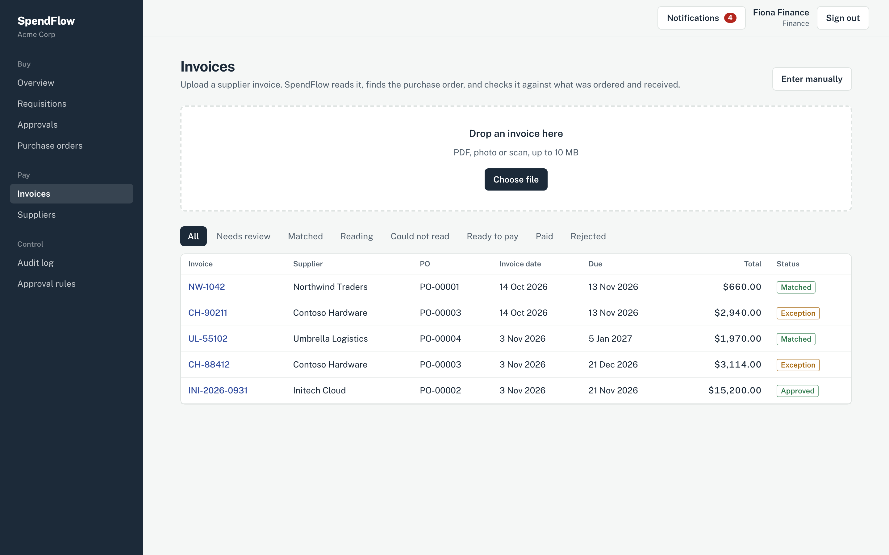<p align="center"><sub><b>Invoices</b>: drag-and-drop upload, filtered by match result</sub></p></td>
</tr>
<tr>
<td>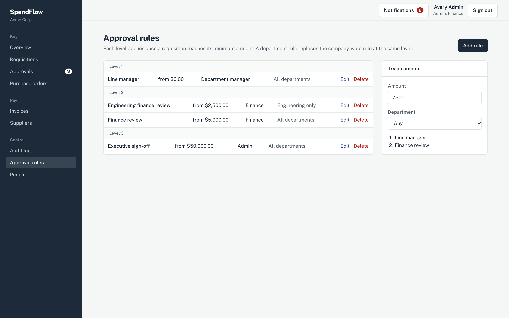<p align="center"><sub><b>Approval rules</b>: levels, thresholds, department overrides</sub></p></td>
<td>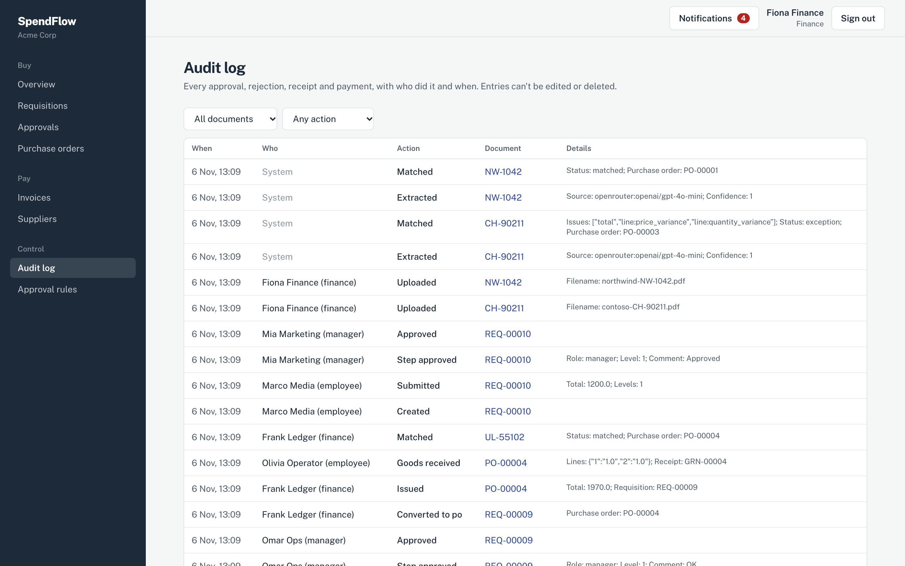<p align="center"><sub><b>Audit log</b>: who did what, when, and why</sub></p></td>
</tr>
</table>

## 🏗 Architecture

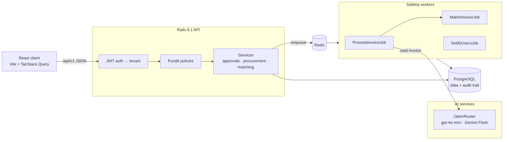

### The procure-to-pay flow

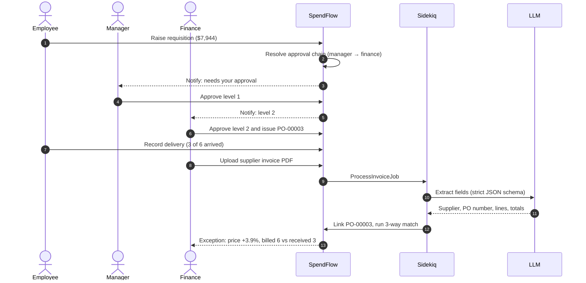

<details>
<summary><b>State machines (AASM)</b></summary>

<br>

**Requisition**

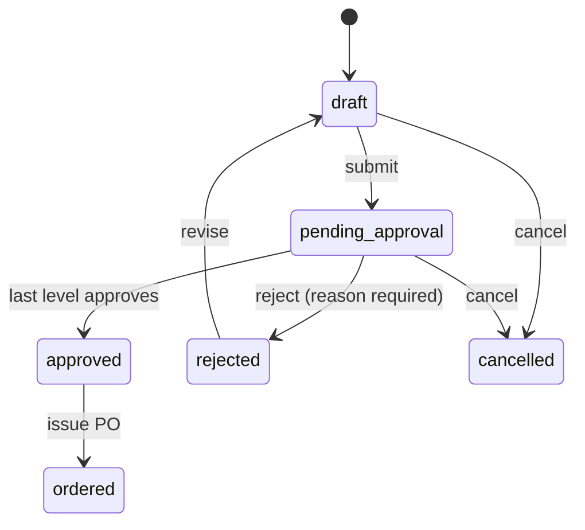

**Invoice**

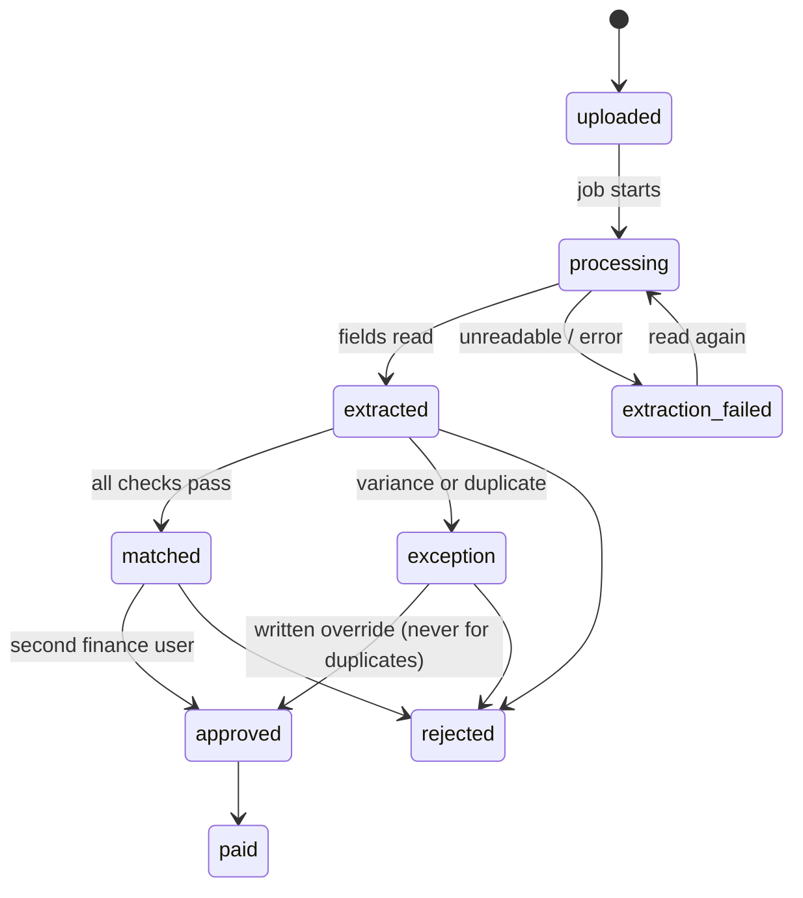

</details>

<details>
<summary><b>Data model</b></summary>

<br>

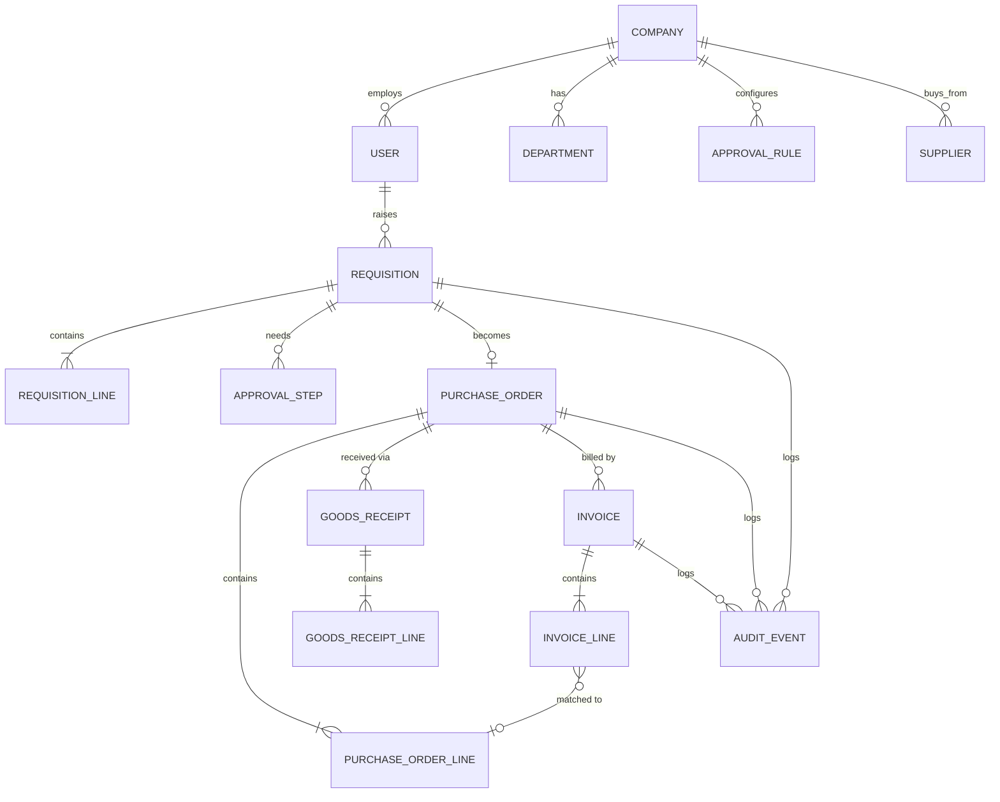

</details>

## 🚀 Quick start

### Option A: Docker (everything in one command)

```bash
git clone <this repo> spendflow && cd spendflow
OPENROUTER_API_KEY=sk-or-... docker compose up --build
```

Then open **http://localhost:8080**. The API prepares the database and loads demo data on first start. Without `OPENROUTER_API_KEY`, invoices are read by the offline extractor, which handles the text samples in `docs/sample-invoices/`.

### Option B: Local development

> Requires Ruby 3.4, Node 24, PostgreSQL 16 and Redis.

```bash
# 1. API (http://localhost:3000)
cd api
bundle install
cp .env.example .env.development.local   # add OPENROUTER_API_KEY
bin/rails db:prepare                      # create, migrate, seed
bin/rails server

# 2. Background jobs
cd api && bundle exec sidekiq -C config/sidekiq.yml

# 3. Client (http://localhost:5173, proxies /api → :3000)
cd web
npm install
npm run dev
```

<details>
<summary><b>Environment variables</b></summary>

<br>

| Variable | Needed for | Default |
|---|---|---|
| `OPENROUTER_API_KEY` | LLM invoice reading | offline heuristic extractor |
| `OPENROUTER_TEXT_MODEL` | Model for PDFs with a text layer | `openai/gpt-4o-mini` |
| `OPENROUTER_VISION_MODEL` | Model for scans and photos | `google/gemini-2.5-flash` |
| `REDIS_URL` | Sidekiq | `redis://localhost:6379/0` |
| `CORS_ORIGINS` | Allowed client origins | `http://localhost:5173` |
| `ACTIVE_STORAGE_SERVICE` | `s3` when API and worker don't share a disk | `local` |
| `S3_BUCKET`, `S3_ACCESS_KEY_ID`, `S3_SECRET_ACCESS_KEY`, `S3_REGION`, `S3_ENDPOINT` | Any S3-compatible bucket | – |

</details>

## 🎬 Demo walkthrough

Every demo account uses the password **`password123`**.

| Account | Role | Try this |
|---|---|---|
| `eli@acme-corp.test` | 👩‍💻 Employee, Engineering | Raise a requisition and watch the approval chain preview |
| `maya@acme-corp.test` | 🧑‍💼 Manager, Engineering | Approve or reject from the inbox |
| `fiona@acme-corp.test` | 💼 Finance | Issue POs, upload invoices, review matches |
| `frank@acme-corp.test` | 💼 Finance | Approve the invoices Fiona uploaded (segregation of duties) |
| `admin@acme-corp.test` | 🛠 Admin | Edit approval rules and people |
| `admin@globex-industries.test` | 🛠 Admin, *another tenant* | Confirm none of Acme's data is visible |

**Three uploads that show off the matcher** (all in [`docs/sample-invoices/`](docs/sample-invoices)):

1. **`contoso-CH-90211.pdf` shows an exception.** It quotes PO-00003 but bills 6 monitors at $395, when the PO price is $380 and only 3 arrived. Both lines are flagged.
2. **`northwind-NW-1042.pdf` is a clean match** against PO-00001.
3. **`northwind-NW-1042-scan.png` is a duplicate.** It goes through the vision model, and the match flags it as a copy of the invoice you just uploaded. *(Needs `OPENROUTER_API_KEY`; the offline extractor can't read images.)*

## ⚡ Performance

Measured with `EXPLAIN (ANALYZE, BUFFERS)` against **400k requisitions, 650k approval steps and 1.6M audit events**. The baseline already has Rails' foreign-key indexes.

| Query | Before | After | |
|---|---:|---:|---:|
| Approval inbox (manager) | 28.26 ms | **0.04 ms** | 706× |
| Company audit log, page 1 | 46.97 ms | **0.02 ms** | 2348× |
| Pending requisitions (finance) | 10.86 ms | **0.06 ms** | 181× |
| Invoices with exceptions | 7.76 ms | **0.03 ms** | 259× |
| Requisition title search | 48.65 ms | **8.44 ms** | 6× |
| Dashboard spend by department | 17.79 ms | **2.81 ms** | 6× |

Indexes alone only got the inbox from 28ms to 16ms. The rest came from changing the query's shape. The full story, including a backfill that briefly made one query *slower*, is in **[docs/PERFORMANCE.md](docs/PERFORMANCE.md)**.

```bash
createdb spendflow_perf
cd api && DATABASE_NAME=spendflow_perf bin/rails db:schema:load perf:seed perf:benchmark LABEL=mine
```

## 🧪 Testing

```bash
cd api && bundle exec rspec        # 132 examples, runs offline
```

| Layer | What's covered |
|---|---|
| Models | Validations, totals, numbering, the AASM transitions, append-only audit events |
| Services | Approval chains and eligibility, PO issue, receiving, 3-way match, duplicates, approval controls |
| AI | OpenRouter calls stubbed with WebMock: request shape, model routing, failure handling |
| Jobs | Extraction → PO lookup → match end to end, retries, failing visibly instead of hanging |
| Requests | Every endpoint, role-based access, cross-tenant access attempts (expect 404) |
| Queries | The SQL approval inbox is checked against the Ruby eligibility rule for every role |

CI (`.github/workflows/ci.yml`) runs RSpec against Postgres, Brakeman, and the client build.

## 📁 Project structure

```
spendflow/
├── api/                          Rails 8.1 API
│   ├── app/
│   │   ├── controllers/api/v1/   JSON endpoints
│   │   ├── policies/             Pundit: who can see and do what
│   │   ├── services/
│   │   │   ├── approvals/        multi-level workflow
│   │   │   ├── procurement/      PO issue, goods receipts
│   │   │   ├── extraction/       OpenRouter + offline extractor, schema, validation
│   │   │   ├── matching/         3-way match, line pairing, PO finder
│   │   │   └── invoices/         apply extraction, run match, approve
│   │   ├── queries/              approval inbox, dashboard
│   │   └── jobs/                 Sidekiq jobs
│   ├── lib/perf/                 dataset generator + EXPLAIN ANALYZE benchmark
│   └── spec/                     RSpec
├── web/                          React 19 + TypeScript client
│   └── src/
│       ├── pages/                one file per screen
│       └── components/           MatchGrid, Stamp, History, dialogs
├── docs/
│   ├── PERFORMANCE.md            before/after write-up
│   ├── perf/                     raw benchmark output (JSON)
│   └── sample-invoices/          PDFs and a scan to upload
├── docker-compose.yml
└── render.yaml                   Render blueprint
```

<details>
<summary><b>API endpoints</b></summary>

<br>

| Method | Path | Notes |
|---|---|---|
| `POST` | `/api/v1/session` | Sign in, returns a JWT |
| `GET` | `/api/v1/dashboard` | Role-aware metrics |
| `GET/POST/PATCH` | `/api/v1/requisitions` | Scoped by role |
| `GET` | `/api/v1/requisitions/inbox` | Requisitions waiting on you |
| `POST` | `/api/v1/requisitions/:id/{submit,approve,reject,cancel,revise}` | Workflow actions |
| `GET/POST` | `/api/v1/purchase_orders` | `POST` issues a PO from an approved requisition |
| `POST` | `/api/v1/purchase_orders/:id/{receive,close,cancel}` | Goods receipt and lifecycle |
| `GET/POST/PATCH` | `/api/v1/invoices` | Multipart upload or manual entry |
| `POST` | `/api/v1/invoices/:id/{rematch,reprocess,approve,reject,pay}` | Review actions |
| `GET` | `/api/v1/invoices/:id/document` | The original file |
| `GET/POST/PATCH/DELETE` | `/api/v1/approval_rules` (+ `/preview`) | Admin |
| `GET/POST/PATCH` | `/api/v1/users`, `/departments`, `/suppliers` | Admin / finance |
| `GET` | `/api/v1/audit_events` | Per record or company-wide |
| `GET/PATCH` | `/api/v1/notifications` (+ `/read_all`) | In-app notifications |

List endpoints accept `page` and `per_page` and return `X-Total-Count`.

</details>

## ☁️ Deploying

[`render.yaml`](render.yaml) is a Render Blueprint for Postgres, Redis, the API, the Sidekiq worker and the nginx-served client. On Render, the API and the worker run on separate machines, so uploads must go to an S3-compatible bucket: set `ACTIVE_STORAGE_SERVICE=s3` and the `S3_*` variables. Also set `OPENROUTER_API_KEY`, `CORS_ORIGINS`, `API_UPSTREAM` (the API's URL), and the same `SECRET_KEY_BASE` on the API and the worker.

<br>

<div align="center">
<sub>Built with Rails, React and a healthy respect for accounts payable.</sub>
</div>
